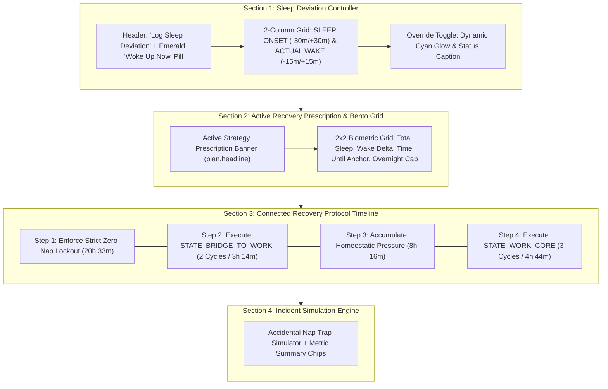

# Patch Notes: v2.2.0 — Event-Driven Circadian State Machine & Dynamic Protocol Flexibility

**Release Version:** `v2.2.0`  
**Platform:** Android (Kotlin + Jetpack Compose, Material 3 Dark)  
**Package:** `com.darkside3211.biphasicsleep`  
**Target:** Xiaomi HyperOS / Android 14+ / Wearable & Biometric Companion  

---

## Overview

Version **`v2.2.0`** introduces a major architectural evolution: decoupling the circadian state machine and sleep guardrails from rigid, passive wall-clock time and transitioning to an **Event-Driven + Dynamic Proximity Architecture**.

Prior to this release, the app inferred sleep based on clock time alone. If real-world plans, errands, or traffic delayed bedtime past a scheduled launch window, the app assumed sleep had already taken place—triggering phantom 90-minute post-wake lockouts and zero-nap locks against users who had logged zero sleep. Version 2.2.0 completely eliminates phantom lockouts, introduces backward-calculated sleep cycle truncation (`3c -> 2c -> 1c`) with flexible anchor pushback (`01:00 -> 02:00`), unlocks a sliding eligibility window for shift naps, converts all interface terminology into plain English, and resolves four UI rendering defects.

---

## Architectural & Protocol Upgrades

### 1. Event-Driven State Transitions (Eliminating Phantom Post-Wake Lockouts)
* **Decoupled from Wall-Clock Time**: Anti-backslide cooldowns (`POST_WAKE_90M_COOLDOWN`) and post-anchor stay-awake lockouts (`STATE_WAKE_LOCKOUT`) now strictly require an event-verified session completion record.
* **Persistent Session State**: `HybridAlarmScheduler` persists `completedAnchorTimestampMillis` and `completedNapTimestampMillis` in local storage upon verified dismissal in `AlarmChallengeActivity` or explicit user confirmation (`Done`).
* **Unfulfilled Anchor Delayed (`UNFULFILLED_ANCHOR_DELAYED`)**: If a nominal launch window passes with zero minutes of logged sleep, the state machine smoothly transitions into `UNFULFILLED_ANCHOR_DELAYED` instead of punishing the user with a lockout or cooldown.
* **Instant Session Reset**: Added a top-level banner allowing users to reset accidental or test completion events in one tap.

---

### 2. Backward-Calculated Sleep Ceiling & Flexible Anchor Pushback
* **Homeostatic Wake Buffer Protection**: When in `UNFULFILLED_ANCHOR_DELAYED`, the engine calculates backward from the next anchor start (`01:00 AM` or `21:00` shift start), maintaining a minimum `6h 00m` to `7h 00m` homeostatic wake buffer.
* **Dynamic Step-Down Logic**:
  * **3 Cycles (4h 44m)**: Recommended when wake time + buffer fits comfortably before the next anchor.
  * **2 Cycles (3h 14m)**: Recommended when a 3-cycle block would breach the minimum wake buffer (e.g., late afternoon arrival).
  * **1 Cycle (1h 44m)**: Rescue cycle when only a single recovery cycle fits before cutoff.
* **+1h Flexible Anchor Pushback**: If taking 2 cycles would infringe on the 7-hour buffer, the engine automatically shifts the displayed next bedtime target back by up to 1 hour (e.g., `01:00 -> 02:00`), visually badged as `NEXT SLEEP ANCHOR SHIFTED`.
* **1-Tap Flexible Cycle Switcher**: A segmented cycle selector on the home screen allows users to freely toggle between 3 Cycles, 2 Cycles, and 1 Cycle.
* **Weekday Logistics Advisory**: Informational notes automatically calculate remaining leeway before the `18:00 (6:00 PM)` departure reference and `21:00` shift start without locking the user into rigid schedule assumptions.

---

### 3. Sliding Eligibility Window for 20-Minute Power Nap
* **Elimination of Fixed 30-Minute Break Lockouts**: The 20m power nap is no longer restricted to a narrow `01:15–01:45` window.
* **Continuous Shift & Wake Period Eligibility**: Stays unlocked and available throughout shift breaks and daytime wake periods as long as:
  1. The nap has not already been taken in the current period.
  2. The user is not inside an active, event-verified 90m post-wake cooldown.
  3. `CurrentTime + 20m <= NextCoreAnchorStart - 4h` (preserving homeostatic pressure for core sleep).

---

### 4. Human-First Plain-English UI & Terminology Overhaul
* Replaced cryptic system codes with clear, descriptive English:
  * `STATE_WKND_CORE` → `Saturday Night Full Sleep`
  * `STATE_BRIDGE_TO_WORK` → `Sunday Night Reset Sleep`
  * `STATE_WORK_CORE` → `Afternoon Workday Sleep`
  * `Adenosine Flush Nap` → `20-Min Power Nap`
  * `STATE_WAKE_LOCKOUT` → `Stay Awake Window`

---

## Visual & Compose Layout Bug Fixes

### 1. Circular Arc Gauge Text Collision
* **Issue**: The next sleep title (`Afternoon Workday Sleep (12:30)`) rendered inside the 180dp circular arc, exceeding the inner diameter and overlapping the gauge stroke.
* **Fix**: Streamlined inner gauge text to `NEXT SLEEP IN` / `[Countdown]` / `AT [Time]` and moved the full title label cleanly beneath the gauge.

### 2. Vertical Status Badge Wrapping (`RE / CO / MM / EN / DE / D`)
* **Issue**: Header text without horizontal weight forced the `RECOMMENDED` status badge pill into a narrow column, wrapping two letters per line across six vertical rows.
* **Fix**: Added `Modifier.weight(1f)` to the card title row, shortened the header to `20-MIN POWER NAP`, and enforced `maxLines = 1` and `softWrap = false` on `StatusBadgePill`.

### 3. Action Button Label Squishing & Vertical Clipping
* **Issue**: Long button CTAs combined with default 24dp horizontal button padding squeezed text into 3 clipped lines next to the `OS Clock` and `Done` buttons.
* **Fix**: Tightened button content padding (`12.dp`), applied `maxLines = 1` / `softWrap = false`, and streamlined labels (`Start 20m Nap (+20m)`, `Start 4h 44m Sleep`, etc.).

---

## Verification & Build Results

* **Unit Test Suite**: `.\gradlew.bat testDebugUnitTest`  
  * **Result**: `BUILD SUCCESSFUL` (All state machine transitions, late arrival step-downs, delayed shift breaks, and edge cases verified).
* **Debug APK Compilation**: `.\gradlew.bat assembleDebug`  
  * **Result**: `BUILD SUCCESSFUL` in 6s.
* **Direct Device Deployment**: Verified on Xiaomi 15 (`24129PN74G` over wireless ADB TLS).

---

# Patch Notes: v2.1.0 — Recovery Architecture & Biometric UI Overhaul

**Release Version:** `v2.1.0`  
**Platform:** Android (Kotlin + Jetpack Compose, Material 3 Dark)  
**Package:** `com.darkside3211.biphasicsleep`  
**Target:** Xiaomi HyperOS / Android 14+ / Wearable & Biometric Companion  

---

## Overview

Version **`v2.1.0`** delivers a complete architectural and visual overhaul of the **Recovery Tab** (`RecoveryScreen`), resolving four critical Compose rendering defects, eliminating text-crushing layout collisions, and elevating the screen to match the high-contrast biometric aesthetic (Oura, Whoop, Apple Health) established across the rest of the application.

---

## Visual Bugs Diagnosed & Resolved

### 1. Vertical Character Wrapping & 220dp Empty Voids in Recovery Steps
* **Symptom**: In the Recovery Protocol timeline, Step 1 and Step 3 squeezed the timestamp window (`04:27 Sun – 01:00 Mon`) into a narrow vertical column that wrapped character-by-character (`04:2 / 7 / Sun / – / 01:0 / 0 / Mon`). In Step 2 and Step 4, longer titles completely starved the label of width, wrapping it across ~18 invisible lines and inflating the card height to ~220dp, leaving a massive empty dark space above the description.
* **Root Cause**: In `VerticalTimelineStepItem`, `step.title` and `step.windowLabel` were placed inside a single `Row` without `Modifier.weight(1f)` on the title. When the title expanded, it pushed the window label into a sub-20dp column.
* **Resolution**:
  * Separated the layout into a **Top Metadata Row** containing the time window pill on the left and a guardrail status badge (`CRITICAL GUARDRAIL` or `PROTOCOL STEP`) on the right.
  * Rendered `step.title` on its own full-width line beneath the metadata row, guaranteeing zero horizontal collisions regardless of title length.
  * Formatted `step.description` with enhanced typographic contrast and generous line spacing (`18.sp`).

---

### 2. Double-Border & Zero-Padding Box Artifacts on Cards
* **Symptom**: Cards across the Recovery tab (Sleep Onset, Actual Wake, and all timeline step items) rendered with an outer rounded colored border, a dark hollow gap inside it, and an inner unrounded sharp rectangle where text touched the edge with zero internal padding.
* **Root Cause**: In Jetpack Compose, calling `.border(...).padding(14.dp)` on a `Surface(modifier = ...)` insets the `Surface` fill color *away* from its own border, causing the background to shrink into an inner unrounded box.
* **Resolution**: Moved all `.padding(14.dp)` modifiers inside the child `Column`/`Row` composables. Card backgrounds now fill flush to their rounded borders (`RoundedCornerShape(14.dp)` / `16.dp`) with consistent internal spacing.

---

### 3. Vertical Letter-Stacking in Quick-Adjust Steppers (`-30m`, `+30m`, `-15m`, `+15m`)
* **Symptom**: The `-30m` / `+30m` and `-15m` / `+15m` time stepper buttons rendered as tall, squished ovals with characters stacked vertically:
  $$\begin{matrix} - \\ 3 \\ 0 \\ m \end{matrix}$$
* **Root Cause**: Default Material 3 `OutlinedButton`s enforce a minimum horizontal `ContentPadding` of `48.dp` (`24.dp` start + `24.dp` end). Inside a half-width card, almost no horizontal width was left for the text.
* **Resolution**: Replaced standard buttons with a lightweight `QuickTimeAdjustButton` composable (`height = 32.dp`, `RoundedCornerShape(8.dp)`, `maxLines = 1`, and subtle accent surface fill). Labels now render cleanly on a single horizontal line.

---

### 4. Dangling & Disconnected Vertical Timeline Rail
* **Symptom**: The vertical timeline line beneath each step number dangled in mid-air, terminating before reaching the next step node.
* **Root Cause**: The line was hardcoded to `.height(60.dp)` and the parent column used `Arrangement.spacedBy(14.dp)`, decoupling the line length from the dynamic card height.
* **Resolution**: Applied `Modifier.height(IntrinsicSize.Min)` on each timeline step `Row`, giving the vertical line `Modifier.fillMaxHeight()` and setting the card's bottom margin to `12.dp` (omitted on the terminal step). The rail now forms an unbroken track connecting Step 1 → Step 2 → Step 3 → Step 4.

---

### 5. Inset Box Rendering on Simulation Preset Cards
* **Symptom**: Selecting simulation presets in the bottom sheet displayed the same double-box border artifact.
* **Resolution**: Relocated `.padding(14.dp)` from the preset `Surface` modifier into its child `Row`.

---

## UI/UX Redesign & Biometric Polish

| Area | Before v2.1.0 | Redesigned in v2.1.0 |
| :--- | :--- | :--- |
| **"Woke Up Now" CTA** | Plain text link button | High-contrast pill action chip with `VerifiedEmeraldBg` surface, 1dp emerald border, and clock icon |
| **Time Cards** | Boxy inner rectangle, wrapped stepper buttons | Flush rounded corners, edit/tune indicator icon in top right, and sleek `QuickTimeAdjustButton` chips |
| **Override Switch** | Dim card with static text | Dynamic border glow (`AnchorCyan.copy(alpha = 0.5f)`) and `"ACTIVE • Overriding home screen..."` description when enabled |
| **Active Strategy Banner** | *Omitted from UI* | Prominently renders `plan.headline` (e.g., `ZERO-NAP LOCKOUT (20h 33m) + 2-CYCLE BRIDGE CAP`) with guardrail icon |
| **Metric Bento Grid** | Plain text-only tiles | Thematic biometric icons (`Bedtime`, `Schedule`, `Lock`, `ShieldMoon`) with bold tabular figures |
| **Incident Simulator** | Unstructured text block | Added incident summary chips (`20:00 Sat Onset` → `04:27 Sun Wake` • `5 Cycles (8h 27m)`) and warning pill |

---

## Architectural & Code Changes

### Modified Files

#### [`app/src/main/java/com/darkside3211/biphasicsleep/ui/MainActivity.kt`](file:///c:/Alarm%20Android%20App/app/src/main/java/com/darkside3211/biphasicsleep/ui/MainActivity.kt)
* Added `QuickTimeAdjustButton` composable with tight horizontal padding and single-line typography.
* Refactored `RecoveryScreen` to integrate the active recovery strategy banner and dynamic override toggle styling.
* Upgraded `MetricTile` to support optional `ImageVector` icons while preserving 100% backward compatibility with `ScheduleScreen`.
* Overhauled `VerticalTimelineStepItem` with `IntrinsicSize.Min` rail measurement and separated metadata/title layout.
* Corrected `SimulationBottomSheetContent` surface modifier ordering.

---

## Verification & Build Results

* **Unit Test Suite**: `.\gradlew.bat testDebugUnitTest`  
  * **Result**: `BUILD SUCCESSFUL` (All state machine transitions, circadian calculators, and lockouts verified).
* **Debug APK Compilation**: `.\gradlew.bat assembleDebug`  
  * **Result**: `BUILD SUCCESSFUL` in 7s.
* **Direct Device Deployment**: Verified on Xiaomi 15 (`24129PN74G` over wireless ADB TLS).
