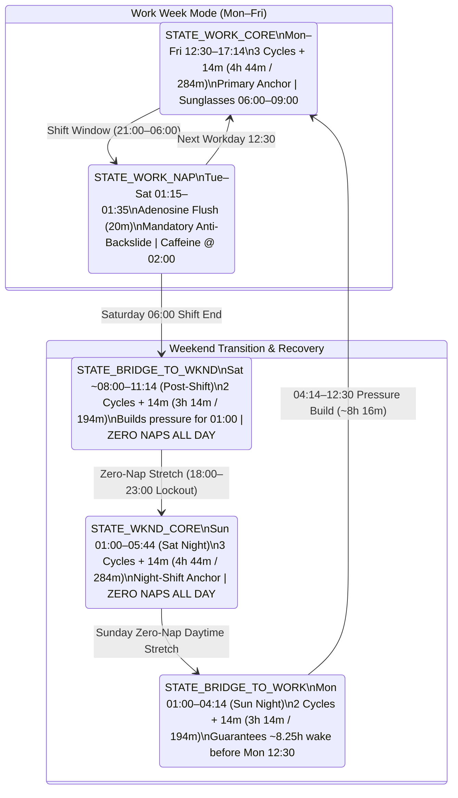

# Biphasic Sleep Anchoring Protocol

A native Android application (**Kotlin + Jetpack Compose**, Material 3 Circadian Dark UI) engineered to automate a **3-cycle (`4h 44m`) biphasic work-week sleep schedule** and a **zero-nap, cycle-capped weekend transition protocol** without triggering circadian flips or `03:00` shift microsleeps.

---

## Core Sleep Constants & Timing Formulas

Alarm triggers are calculated dynamically from fixed **90-minute ultradian sleep cycles** plus a constant **14-minute sleep onset latency buffer**:

| Parameter | Value | Formula / Notes |
| :--- | :--- | :--- |
| **Cycle Duration** | `90 minutes` | Standard ultradian sleep cycle |
| **Latency Buffer** | `14 minutes` | Average sleep onset latency |
| **3-Cycle Core Block** | `284 minutes` (`4h 44m`) | $(3 \times 90) + 14\text{ min}$ |
| **2-Cycle Bridge Block** | `194 minutes` (`3h 14m`) | $(2 \times 90) + 14\text{ min}$ |
| **Adenosine Flush Nap** | `20 minutes` | Strictly capped to stay in Stage 1/2 light sleep and avoid slow-wave sleep inertia |
| **Shift Window** | `21:00` – `06:00` | Monday – Friday overnight work shift |

---

## Weekly State Machine Architecture

The protocol operates as a two-mode circadian state machine (**Work Mode** vs. **Weekend Mode**) linked by two **2-Cycle Bridge States** that deliberately restrict sleep duration to build homeostatic sleep pressure for the next anchor shift.



| State ID | Day / Phase | Mode Type | Start – End | Duration | System Rules & Physiological Triggers |
| :--- | :--- | :--- | :--- | :--- | :--- |
| **`STATE_WORK_CORE`** | Mon – Fri (Afternoon) | 3-Cycle Core Anchor | `12:30` – `17:14` | `4h 44m` | Primary workday sleep. Keep time-awake `<10h` by `03:00`. Wear dark sunglasses on commute home (`06:00`–`09:00`) to blunt daylight signaling. |
| **`STATE_WORK_NAP`** | Tue – Sat (Mid-Shift) | Adenosine Flush | `01:15` – `01:35` | `20m` | Mandatory mid-shift nap to clear adenosine before the `03:00` circadian nadir. Delay sugar-free caffeine intake until `02:00`. |
| **`STATE_BRIDGE_TO_WKND`** | Saturday (Morning) | 2-Cycle Bridge | `~08:00` – `11:14` | `3h 14m` | Post-Friday shift recovery. Capped at 2 cycles so you are tired enough to sleep at `01:00` Sunday. **Zero naps allowed all day.** |
| **`STATE_WKND_CORE`** | Sunday (Early AM) | 3-Cycle Night Anchor | `01:00` – `05:44` | `4h 44m` | Weekend night-shift alignment. **Zero naps allowed all day Sunday** to protect Monday transition. |
| **`STATE_BRIDGE_TO_WORK`** | Monday (Early AM) | 2-Cycle Bridge | `01:00` – `04:14` | `3h 14m` | Critical transition back to work mode. Waking at `04:14` guarantees an `~8.25h` wake window so you can fall asleep at `12:30` Monday. |

---

## Key Features & Modules

### 1. Dynamic Cycle Alarm Calculator & Hybrid Scheduler
- One-tap triggers calculated dynamically from `System.currentTimeMillis()`:
  - **Start 3-Cycle Core** (`+4h 44m` / `284m`)
  - **Start 2-Cycle Bridge** (`+3h 14m` / `194m`)
  - **Start 20m Flush Nap** (`+20m`)
- **Hybrid Alarm Execution**: Schedules Doze-piercing hardware alarms via `AlarmManager.setAlarmClock()` (with lock-screen wake challenge UI) and optionally mirrors alarms to the native Android System Clock app via `AlarmClock.ACTION_SET_ALARM`.

### 2. State-Aware Mode Guardrails
- Automatically detects the active circadian state from the current day/time and highlights the recommended sleep block.
- On Sunday night / Monday `01:00` (`STATE_BRIDGE_TO_WORK`), locks the primary CTA to the **2-Cycle Bridge (`3h 14m` $\rightarrow$ `04:14` wake)** and warns if the user attempts to select a 3-cycle block (waking at `05:44` leaves `<7h` before the `12:30` Monday Work Core, causing pre-shift insomnia).

### 3. Weekend Anti-Nap / Boredom Lockout Timer
- Active during Saturday and Sunday daytime wake windows (`STATE_BRIDGE_TO_WKND` and `STATE_WKND_CORE`), with heightened alert during the **`18:00`–`23:00` Evening Boredom Danger Zone**.
- Displays a live countdown to the `01:00` overnight anchor and locks out the 20-minute flush nap button to prevent accidental multi-cycle evening crashes.

### 4. Multi-Modal Wake-Up Confirmation & Anti-Backslide Check
Configurable and combinable wake verification mechanisms to prevent turning a 20-minute flush nap into a full core sleep crash:
1. **Delayed 5-Minute Anti-Backslide Secondary Check-In**: Automatically schedules a secondary verification alarm `5 minutes` after primary alarm dismissal. If not confirmed within the check-in window, the full alarm and physical challenge re-ignite.
2. **Physical Step Counter Challenge**: Uses `Sensor.TYPE_STEP_DETECTOR` (with an accelerometer step-peak fallback) to require walking out of bed (`15 steps` default, configurable `5–50`).
3. **QR / Barcode Scanner Challenge**: Uses **CameraX + Google ML Kit Barcode Scanning** to require scanning any physical barcode or a registered out-of-bed barcode.

### 5. Deviation Recovery Calculator & Incident Simulator
- **Dynamic Recovery Calculation**: Input actual sleep onset and actual wake timestamps after an unscheduled nap or oversleep to compute completed ultradian cycles, wake-window delta, and `Time_Until_Next_Anchor` (`12:30` or `01:00`).
  - **Rule 1 (`Time_Until_Next_Anchor >= 16h`)**: Enforces a strict **Zero-Nap Lockout** for the entire wake stretch until the next anchor.
  - **Rule 2 (`8h–12h` until Monday `12:30` Work Core)**: Automatically caps the preceding `01:00` overnight block to **2 cycles (`3h 14m`)** to preserve homeostatic sleep pressure.
- **Interactive Incident Replay**: Includes a one-tap preset for the **Oct 17–18 "Accidental Nap Trap" Incident** (`20:00` Sat crash $\rightarrow$ `04:27` Sun 5-cycle wake $\rightarrow$ `20h 33m` Zero-Nap Lockout $\rightarrow$ `01:00`–`04:14` Mon 2-cycle bridge $\rightarrow$ `12:30` Mon Work Core).

---

## Project Structure

```text
app/src/main/java/com/antigravity/biphasicsleep/
├── alarm/
│   ├── AlarmReceiver.kt                  # BroadcastReceiver for primary & 5m anti-backslide alarms
│   ├── AlarmRingingService.kt            # Foreground service with wake lock, alarm audio & vibration
│   ├── BootCompletedReceiver.kt          # Restores armed alarms across device reboots
│   └── HybridAlarmScheduler.kt           # AlarmManager.setAlarmClock() + ACTION_SET_ALARM integration
├── challenge/
│   ├── BarcodeScannerChallengeView.kt    # CameraX + ML Kit QR/Barcode wake challenge
│   └── StepCounterChallengeController.kt # TYPE_STEP_DETECTOR + accelerometer fallback controller
├── data/
│   └── ProtocolPreferencesRepository.kt  # Persistence for protocol config, active alarms & deviations
├── domain/
│   ├── CircadianStateMachine.kt          # 5-state weekly evaluation engine & mode guardrails
│   ├── DeviationRecoveryCalculator.kt    # Unscheduled sleep recovery math & incident presets
│   ├── ProtocolState.kt                  # State definitions, actions & physiological advisories
│   └── SleepProtocolConfig.kt            # Core cycle constants & challenge settings
└── ui/
    ├── AlarmChallengeActivity.kt         # Full-screen lock-screen wake challenge & check-in UI
    ├── MainActivity.kt                   # 4-tab Jetpack Compose command deck & simulator UI
    ├── ProtocolViewModel.kt              # Reactive UI state holder & simulation clock engine
    └── theme/                            # Low-blue-light Circadian Dark Material 3 theme
```

---

## Tech Stack & Requirements

- **Language**: Kotlin 2.0 (`jvmTarget = 17`)
- **UI Framework**: Jetpack Compose (Material 3, Circadian Dark Theme)
- **Android SDK**: `compileSdk = 35`, `targetSdk = 35`, `minSdk = 26` (Android 8.0+)
- **Hardware & Vision**: Android Sensor Framework (`TYPE_STEP_DETECTOR` / `TYPE_ACCELEROMETER`), CameraX (`1.4.0`), Google ML Kit Barcode Scanning (`17.3.0`)
- **Testing**: JUnit 4 deterministic domain test suite (`BiphasicSleepProtocolTest.kt`)

---

## Building & Running

### Run Unit Tests
```powershell
.\gradlew.bat testDebugUnitTest
```

### Build Debug APK
```powershell
.\gradlew.bat assembleDebug
```
The compiled APK will be generated at `app/build/outputs/apk/debug/app-debug.apk`.
