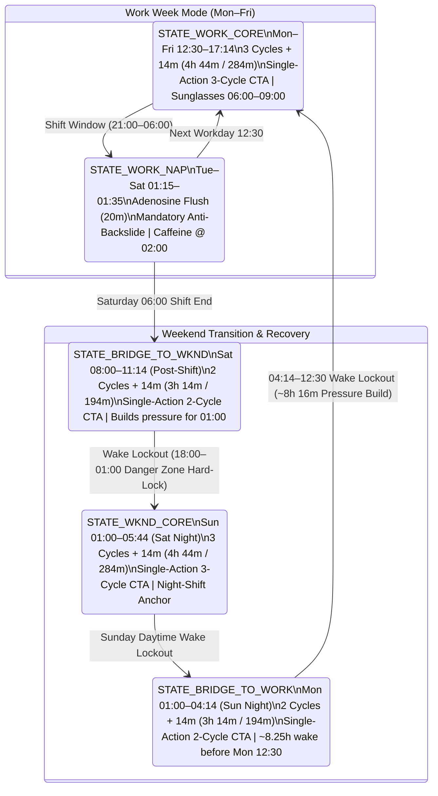

# Biphasic Sleep Anchoring Protocol

A native Android application (**Kotlin + Jetpack Compose**, Material 3 Circadian Dark UI) engineered to automate a **3-cycle (`4h 44m`) biphasic work-week sleep schedule** and a **zero-nap, cycle-capped weekend transition protocol** without triggering circadian flips or `03:00` shift microsleeps.

---

## Core Sleep Constants & Timing Formulas

Alarm triggers are calculated dynamically from fixed **90-minute ultradian sleep cycles** plus a constant **14-minute sleep onset latency buffer**:

| Parameter | Value | Formula / Notes |
| :--- | :--- | :--- |
| **Cycle Duration** | `90 minutes` | Standard ultradian sleep cycle |
| **Latency Buffer** | `14 minutes` | Average sleep onset latency |
| **3-Cycle Core Block** | `284 minutes` (`4h 44m`) | $(3 \times 90) + 14\text{ min}$ |
| **2-Cycle Bridge Block** | `194 minutes` (`3h 14m`) | $(2 \times 90) + 14\text{ min}$ |
| **Adenosine Flush Nap** | `20 minutes` | Strictly capped to stay in Stage 1/2 light sleep and avoid slow-wave sleep inertia |
| **Pre-Anchor Nap Cutoff** | `270 minutes` (`4h 30m`) | Minimum required wakefulness before any Core or Bridge anchor |
| **Post-Wake Cooldown** | `90 minutes` | Anti-backslide lockout immediately following any Core or Bridge wake-up |
| **Shift Window** | `21:00` – `06:00` | Monday – Friday overnight work shift |

---

## Weekly State Machine Architecture (v2.0 Hard-Lock Protocol)

The protocol operates as a strict state machine alternating between **Active Sleep Launch Windows** and **Wake Lockout Windows** (`STATE_WAKE_LOCKOUT`) linked by two **2-Cycle Bridge States** that deliberately restrict sleep duration to build homeostatic sleep pressure for the next anchor shift.



| State ID | Day / Phase | Mode Type | Start – End | Duration | System Rules & UI Enforcement |
| :--- | :--- | :--- | :--- | :--- | :--- |
| **`STATE_WORK_CORE`** | Mon – Fri (Afternoon) | 3-Cycle Core Anchor | `12:30` – `17:14` | `4h 44m` | Primary workday sleep (`11:30`–`14:00` launch window). Render **ONLY** the 3-Cycle Core (`+284m`) CTA. Wear dark sunglasses on commute home (`06:00`–`09:00`). |
| **`STATE_WORK_NAP`** | Tue – Sat (Mid-Shift) | Adenosine Flush | `01:15` – `01:35` | `20m` | Mandatory mid-shift nap (`01:00`–`02:00` window) before the `03:00` circadian nadir. Delay sugar-free caffeine intake until `02:00`. |
| **`STATE_BRIDGE_TO_WKND`** | Saturday (Morning) | 2-Cycle Bridge #1 | `08:00` – `11:14` | `3h 14m` | Deliberately capped at 2 cycles (`06:30`–`09:30` launch window) to leave residual sleep pressure for `01:00` Sunday. Render **ONLY** the 2-Cycle Bridge (`+194m`) CTA. |
| **`STATE_WKND_CORE`** | Sunday (Early AM) | 3-Cycle Weekend Block | `01:00` – `05:44` | `4h 44m` | Full 3-cycle recovery sleep anchored at `01:00` (`00:00`–`02:30` launch window) to preserve night-shift rhythm. Render **ONLY** the 3-Cycle Core (`+284m`) CTA. |
| **`STATE_BRIDGE_TO_WORK`** | Monday (Early AM) | 2-Cycle Bridge #2 | `01:00` – `04:14` | `3h 14m` | Deliberately capped at 2 cycles (`00:00`–`02:30` launch window). Render **ONLY** the 2-Cycle Bridge (`+194m`) CTA and hard-lock 3-Cycle Core to protect Monday's `12:30` block. |
| **`STATE_WAKE_LOCKOUT`** | Daily (Between Anchors) | Homeostatic Pressure Build | All non-sleep hours | Variable | Replaces Primary Anchor alarm card with a locked **`WAKE LOCKOUT ACTIVE`** status card and live countdown to the next scheduled anchor. |

---

## Key Features & Modules

### 1. Single-Action Primary Anchor & Hybrid Alarm Scheduler
- **Single-Action Enforcement**: Never displays both `3-Cycle Core` and `2-Cycle Bridge` simultaneously. During an active launch window, the top card renders only the single permitted cycle button for that phase (`+284m` Core or `+194m` Bridge).
- **Active Wake-Window Hard Lockout (`STATE_WAKE_LOCKOUT`)**: Outside scheduled launch windows (or immediately after completing a block), replaces the arm CTA with a locked banner (`"WAKE LOCKOUT ACTIVE — Building Homeostatic Pressure"`) and live countdown timer. Requires a **5-second continuous long-press confirmation modal** for any emergency manual override.
- **Hybrid Alarm Execution**: Schedules Doze-piercing hardware alarms via `AlarmManager.setAlarmClock()` (with lock-screen wake challenge UI) and optionally mirrors alarms to the native Android System Clock app via `AlarmClock.ACTION_SET_ALARM`.

### 2. Dynamic 20-Minute Nap Lockout Calculator (4 Strict Rules)
Real-time evaluation of `Current_Time`, `Last_Wake_Time`, and `Next_Scheduled_Anchor` (`12:30` Mon–Fri, `01:00` Sat/Sun):
1. **Rule 1 (Pre-Anchor `4.5h` Cutoff)**: Hard-locks the `20m` Nap button when `Time_Until_Next_Anchor < 270 minutes` (e.g., after `08:00` Mon–Fri before `12:30` Core, or after `20:30` Sat/Sun before `01:00`) so napping cannot bleed off required homeostatic sleep pressure.
2. **Rule 2 (Post-Wake `90m` Anti-Backslide Cooldown)**: Hard-locks the `20m` Nap button for `90 minutes` immediately following any Core or Bridge wake-up (e.g., `04:14`–`05:44` Monday morning).
3. **Rule 3 (Weekend Evening Danger Zone `18:00`–`01:00`)**: Hard-locks the `20m` Nap button on Saturday and Sunday evenings (`18:00`–`01:00`) to prevent evening boredom naps from converting into early 5-cycle sleep crashes.
4. **Rule 4 (Permitted Nap Windows)**: Unlocks the `20m` Nap button **only** during the Mid-Shift Nap window (`01:00`–`02:00` Tue–Sat) OR during daytime wake windows when both `Time_Since_Last_Wake >= 90m` and `Time_Until_Next_Anchor >= 270m`.

### 3. Multi-Modal Wake-Up Confirmation & Anti-Backslide Check
Configurable and combinable wake verification mechanisms to prevent turning a 20-minute flush nap or bridge block into an unscheduled crash:
1. **Mandatory 5-Minute Anti-Backslide Secondary Check-In**: Automatically schedules a secondary verification alarm `5 minutes` after primary alarm dismissal requiring active confirmation that the user is vertical and out of bed. If unconfirmed, the full alarm and physical challenge re-ignite.
2. **Physical Step Counter Challenge**: Uses `Sensor.TYPE_STEP_DETECTOR` (with an accelerometer step-peak fallback) to require walking out of bed (`15 steps` default, configurable `5–50`).
3. **QR / Barcode Scanner Challenge**: Uses **CameraX + Google ML Kit Barcode Scanning** to require scanning any physical barcode or a registered out-of-bed barcode.

### 4. Deviation Recovery Calculator & Incident Simulator
- **Dynamic Recovery Calculation**: Input actual sleep onset and actual wake timestamps after an unscheduled nap or oversleep to compute completed ultradian cycles, wake-window delta, and `Time_Until_Next_Anchor` (`12:30` or `01:00`).
  - **Rule 1 (`Time_Until_Next_Anchor >= 16h`)**: Enforces a strict **Zero-Nap Lockout** for the entire wake stretch until the next anchor.
  - **Rule 2 (`8h–12h` until Monday `12:30` Work Core)**: Automatically caps the preceding `01:00` overnight block to **2 cycles (`3h 14m`)** to preserve homeostatic sleep pressure.
- **Interactive Incident & Guardrail Presets**: Includes simulation presets for **Incident #1** (`20:00` Sat Boredom Danger Zone & `04:27` Sun 5-cycle wake recovery), **Incident #2** (`04:30` Mon Post-Bridge `90m` Cooldown & `06:05` Mon Active Wake Lockout), and `08:30` Mon Pre-Anchor `4.5h` Cutoff.

---

## Project Structure

```text
app/src/main/java/com/darkside3211/biphasicsleep/
├── alarm/
│   ├── AlarmReceiver.kt                  # BroadcastReceiver for primary & 5m anti-backslide alarms
│   ├── AlarmRingingService.kt            # Foreground service with wake lock, alarm audio & vibration
│   ├── BootCompletedReceiver.kt          # Restores armed alarms across device reboots
│   └── HybridAlarmScheduler.kt           # AlarmManager.setAlarmClock() + ACTION_SET_ALARM integration
├── challenge/
│   ├── BarcodeScannerChallengeView.kt    # CameraX + ML Kit QR/Barcode wake challenge
│   └── StepCounterChallengeController.kt # TYPE_STEP_DETECTOR + accelerometer fallback controller
├── data/
│   └── ProtocolPreferencesRepository.kt  # Persistence for protocol config, active alarms & deviations
├── domain/
│   ├── CircadianStateMachine.kt          # v2.0 launch window engine, wake lockout & 4-rule nap calculator
│   ├── DeviationRecoveryCalculator.kt    # Unscheduled sleep recovery math & incident presets
│   ├── ProtocolState.kt                  # State definitions, lockout models & physiological advisories
│   └── SleepProtocolConfig.kt            # Core cycle constants, cutoff/cooldown & launch window settings
└── ui/
    ├── AlarmChallengeActivity.kt         # Full-screen lock-screen wake challenge & check-in UI
    ├── BiometricComponents.kt            # Custom Canvas arc gauges, 24h timeline bar & status pills
    ├── BiphasicProtocolViewModel.kt      # Reactive UI state holder & v2.0 simulation clock engine
    ├── MainActivity.kt                   # 4-tab Jetpack Compose command deck & hard-lock guardrails
    └── theme/                            # Low-blue-light Circadian Biometrics Material 3 theme
```

---

## Tech Stack & Requirements

- **Language**: Kotlin 2.0 (`jvmTarget = 17`)
- **UI Framework**: Jetpack Compose (Material 3, Circadian Dark Theme)
- **Android SDK**: `compileSdk = 35`, `targetSdk = 35`, `minSdk = 26` (Android 8.0+)
- **Hardware & Vision**: Android Sensor Framework (`TYPE_STEP_DETECTOR` / `TYPE_ACCELEROMETER`), CameraX (`1.4.0`), Google ML Kit Barcode Scanning (`17.3.0`)
- **Testing**: JUnit 4 deterministic domain test suite (`BiphasicSleepProtocolTest.kt`)

---

## Building & Running

### Run Unit Tests
```powershell
.\gradlew.bat testDebugUnitTest
```

### Build Debug APK

```powershell

.\gradlew.bat assembleDebug

```

The compiled APK will be generated at `app/build/outputs/apk/debug/app-debug.apk`. 

---

---

## Why is this free? (And how to support)

I built **BiphasicSleep** for myself to survive a `21:00` – `06:00` night shift without wrecking my circadian rhythm. Sleep utilities shouldn't lock basic ultradian math or alarm guardrails behind a monthly paywall or intrusive ads, so this app is—and will always be—**100% free**.

The full source code is publicly available here so anyone can inspect the state-machine logic, compile the APK locally for personal use, or reference the architecture.

If this app helped you survive your night shift or fixed your sleep schedule and you want to fuel my next `02:00` coffee:
- ☕ **Support / Tip Jar:** *(Ko-fi / Buy Me a Coffee link coming soon)*

---

## License & Attribution

Copyright © 2026 **Gerard Dominic Baldo ([@darkside3211](https://github.com/darkside3211))**. All Rights Reserved.

This project is released under a **Source-Available Non-Commercial & Attribution License**:
- **Personal & Educational Use:** You are free to view, fork, and modify the source code strictly for personal, educational, or portfolio evaluation purposes.
- **Mandatory Attribution:** Any fork, public reference, or modified personal build **must** retain the copyright notice and visibly credit **Gerard Dominic Baldo (`@darkside3211`)** as the original author with a direct link back to [https://github.com/darkside3211/BiphasicSleep](https://github.com/darkside3211/BiphasicSleep).
- **No Commercial Use or App Store Redistribution:** No person or entity other than the original author may monetize this work, repackage it into a paid or ad-supported product, or upload copies/derivatives to the Google Play Store, Apple App Store, or third-party APK repositories.

See the [LICENSE](LICENSE) file for the full legal terms.
